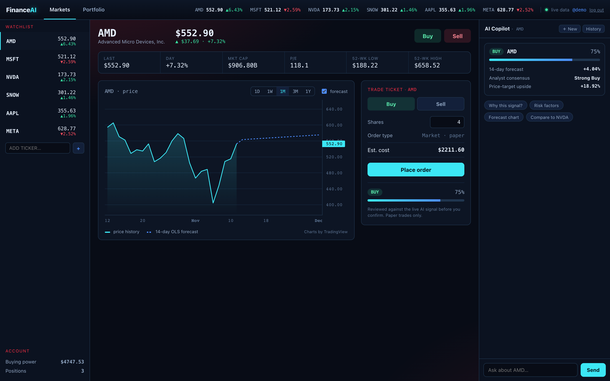
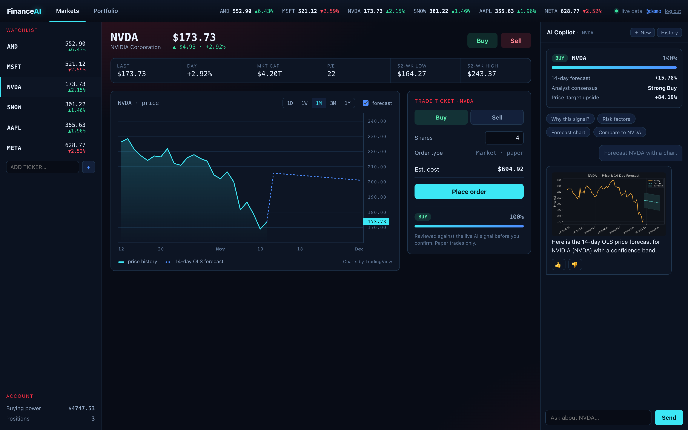
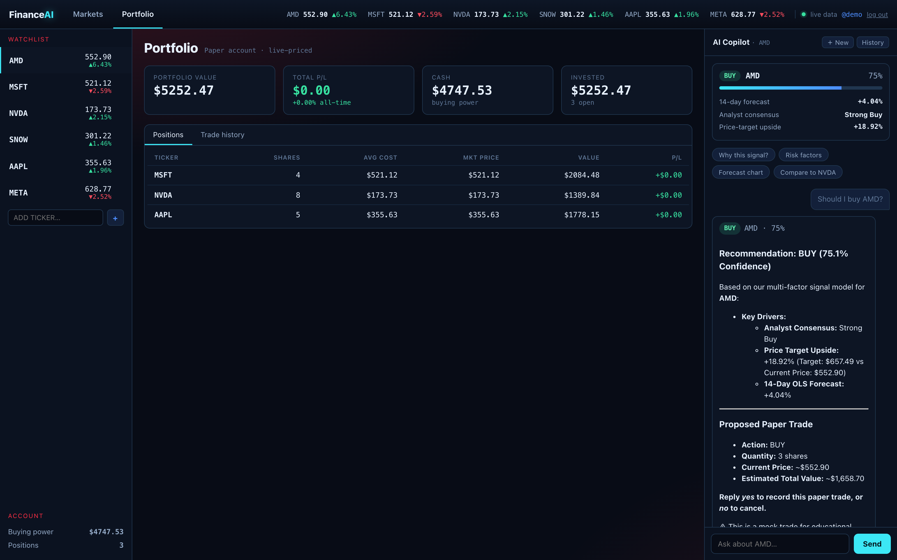
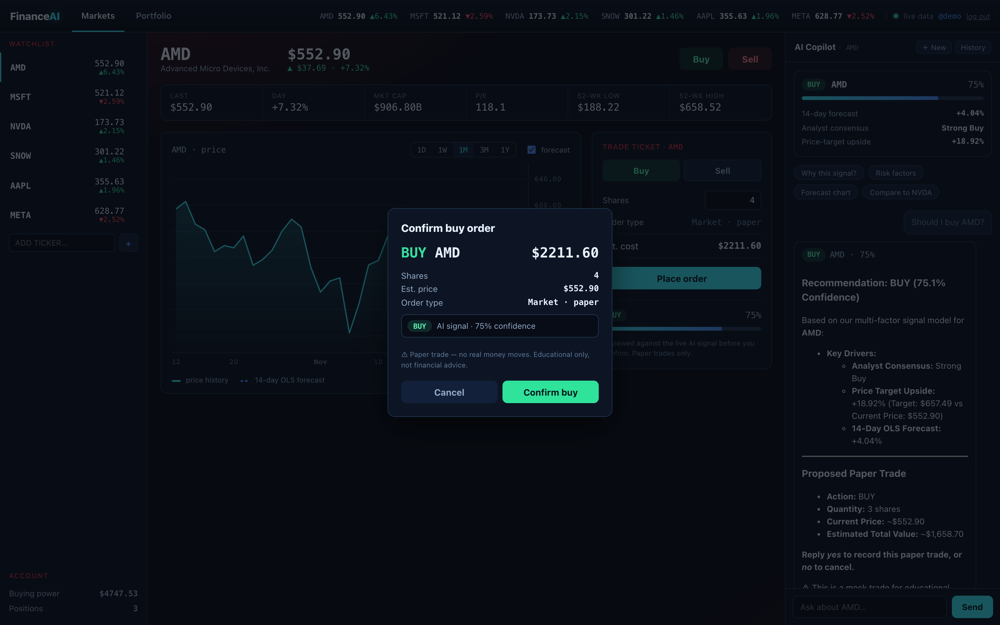
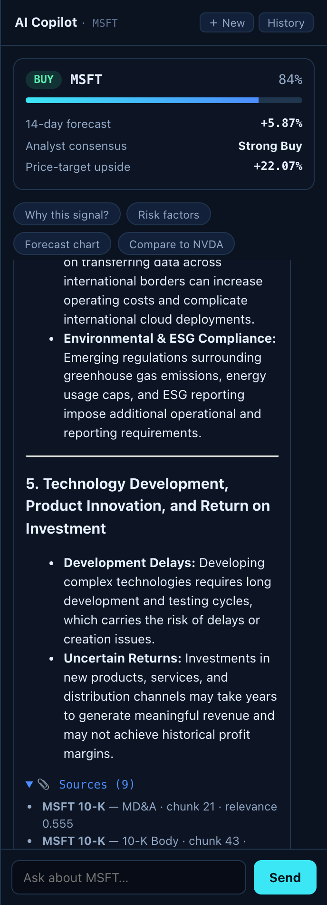
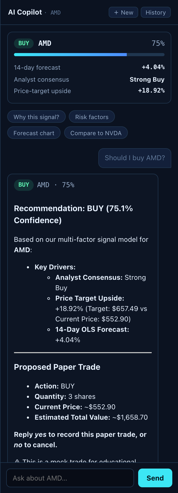
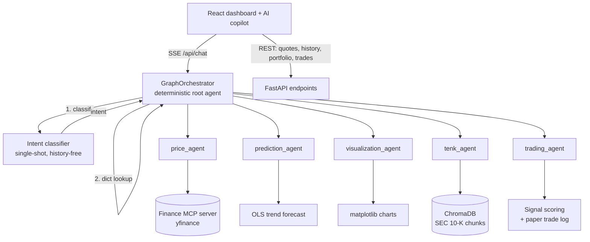

# FinanceAI

**A multi-agent AI stock-analysis desk where plain Python code, not an LLM, decides which agent answers.**

[](https://github.com/josephhdu/FinanceAgent/actions/workflows/ci.yml)
[](LICENSE)




Ask stock questions in plain English and get streamed answers: live prices, trend
forecasts, charts, answers cited from SEC 10-K filings, and paper trades you approve
before they run. It sits inside a full trading-desk dashboard with a watchlist,
interactive charts, a portfolio view and an AI copilot.

Built with **Google ADK + Gemini**, **FastAPI**, **MCP**, **ChromaDB** and **React + TypeScript**.

> **Paper trading only.** No real orders are ever placed. Nothing here is financial advice.

---

## Highlights

- **Deterministic multi-agent routing.** A classifier labels each question with an
  intent, and a Python dict maps that intent to a fixed pipeline of specialist
  agents. Routing is reproducible, cheap, and unit-tested without a single model call.
- **RAG over SEC 10-K filings.** Questions about a company's risks or business are
  answered from its actual annual report and cite the filing sections they came from.
- **Live market data over MCP.** Agents call yfinance tools through a Model
  Context Protocol server, and each agent gets access to only the tools it needs.
- **Human-in-the-loop trading.** The AI proposes a trade with its reasoning, and nothing
  is recorded until you say "yes" or confirm the trade ticket.
- **Guardrails.** Prompt-injection blocking, PII masking, an input-token limit, and an
  enforced not-financial-advice disclaimer.
- **Built to run with other people.** JWT login, per-user portfolios and chat history,
  structured audit logs, a metrics endpoint, and CI on every push.

---

## Screenshots

<table>
  <tr>
    <td width="50%">
      
      <br><sub><b>Forecast + chart.</b> “Forecast NVDA with a chart” runs the visualization agent; the chart is streamed into the chat.</sub>
    </td>
    <td width="50%">
      
      <br><sub><b>Portfolio.</b> Positions are rebuilt from the user's trade log and priced live.</sub>
    </td>
  </tr>
  <tr>
    <td width="50%">
      
      <br><sub><b>Trade ticket.</b> Every GUI order shows the AI signal and needs an explicit confirm.</sub>
    </td>
    <td width="50%" align="center">
      
      
      <br><sub><b>Left:</b> risk factors from Microsoft's 10-K, with sources. <b>Right:</b> a BUY signal and proposed paper trade waiting for “yes”.</sub>
    </td>
  </tr>
</table>

---

## How it works



The whole routing decision is this table in [`agent.py`](app/stock_agent/agent.py):

```python
_ROUTE_MAP = {
    "PRICE":               ["price_agent"],
    "PREDICTION":          ["prediction_agent"],
    "VISUALIZATION":       ["visualization_agent"],
    "PRICE_PREDICTION":    ["price_agent", "prediction_agent"],
    "PRICE_PREDICT_CHART": ["price_agent", "prediction_agent", "visualization_agent"],
    "ANNUAL_REPORT":       ["tenk_agent"],
    "TRADE_ANALYSIS":      ["trading_agent"],
}
```

Each chat message goes through these steps:

1. **Injection check:** prompt-injection attempts are blocked before any model runs.
2. **Pending trade:** if a trade is waiting for approval, a short “yes”/“no” goes
   straight to the trading agent. Any other message cancels the stale proposal.
3. **Classify:** one Gemini call turns the (PII-masked) message into an intent.
4. **Route:** the intent is looked up in `_ROUTE_MAP`. Unknown intents get a polite refusal.
5. **Run the pipeline:** the specialists run in order, streaming tokens, charts, and
   citations to the browser over Server-Sent Events.
6. **Disclaimer:** answers that involve trades always end with a not-financial-advice note.

---

## Engineering decisions

- **Why not let the LLM route?** An LLM router is nondeterministic, adds a model call
  per hop, and can only be tested by running the model. A dict lookup is free,
  repeatable, and covered by unit tests that also check it matches the eval suite.
- **The classifier sees no chat history.** At first it ran inside the ADK session.
  As the conversation grew, it began *answering* questions instead of classifying
  them. A single-shot call on just the current message with JSON output forced on
  made it reliable.
- **Charts never reach the model.** A chart tool returns about 50 KB of base64 PNG,
  roughly 170K tokens, which hung the model. An `after_tool_callback` strips the image
  out of the tool result and sends it to the browser separately.
- **Guardrails placed for streaming.** ADK fires `after_model_callback` on *every*
  streamed chunk, so per-response checks there would run hundreds of times. PII
  masking and the token limit run before the model call, and the disclaimer is added
  by the server once the full answer is assembled.
- **Cost tiers in one file.** Classification, price formatting, and chart captions
  run on Gemini Flash-Lite. Forecasting, RAG, and trading run on Flash. Changing a
  model is a one-line edit in [`model_config.py`](app/stock_agent/model_config.py).

More detail on each, plus per-user scoping and the approval flow, is in the
**[app README](app/README.md#key-design-decisions)**.

---

## Tech stack

| Layer | Tools |
|---|---|
| Agents & LLM | Google ADK, Gemini (Flash / Flash-Lite), google-genai |
| Tools & data | MCP (FastMCP server), yfinance, pandas, matplotlib |
| RAG | ChromaDB, sentence-transformers (`all-MiniLM-L6-v2`), SEC EDGAR ingestion |
| Backend | FastAPI, Server-Sent Events, SQLite (sessions, users), PyJWT, bcrypt |
| Frontend | React 18, TypeScript, Vite, TradingView lightweight-charts, marked + DOMPurify |
| Quality | pytest, eval harness with pass/fail thresholds, GitHub Actions |

---

## Quick start

You need Python 3.10+, Node 20+, and a [Gemini API key](https://aistudio.google.com/apikey).

```bash
cd app
python -m venv .venv && source .venv/bin/activate
pip install -r requirements.txt
cp .env.example .env          # add GOOGLE_API_KEY, JWT_SECRET, and your login

# optional: build the 10-K index for a few companies
python scripts/download_10ks.py MSFT NVDA SNOW

# build the React frontend (FastAPI serves it)
cd frontend && npm install && npm run build && cd ..

uvicorn web_server:app --port 8080
```

Open <http://localhost:8080>, sign in with the account from `.env`, and try:

- *“What's MSFT trading at?”*
- *“Forecast NVDA with a chart”*
- *“What are Snowflake's risk factors?”*
- *“Should I buy AMD?”* → reply **yes** to record a paper trade

For UI development, run `npm run dev` in `app/frontend/` to get hot reload on :5173,
with `/api` proxied to a backend on :8000. More setup notes are in the
[app README](app/README.md#setup--run).

---

## Testing & evaluation

```bash
cd app
pytest                          # 25 unit tests: routing, trade approval, guardrails, portfolio accounting (no model calls)
python main.py --check          # build the agent graph and print the routing table
python eval/run_eval.py --gate  # score intent accuracy with real model calls; non-zero exit below threshold
```

The unit suite and the frontend type-check/build run in GitHub Actions on every push.
The eval thresholds are in [`eval/thresholds.yaml`](app/eval/thresholds.yaml):
intent accuracy ≥ 80%, routing 100%.

---

## Repository layout

```
app/
  web_server.py      FastAPI: SSE chat + REST API, serves the built frontend
  stock_agent/       orchestrator, specialist agents, tools, MCP server, guardrails, auth, RAG
  frontend/          React + TypeScript dashboard
  tests/  eval/      unit tests and the eval harness
  scripts/           10-K ingestion, add_user
design/              original architecture blueprint and PRD (larger than what's built)
assets/screenshots/  images used in this README
```

---

## Roadmap

The original [design blueprint](design/) covers more than this v1. Still to build:
GraphRAG research agent · agent-to-agent (A2A) protocol · background price alerts ·
PDF reports · role-based access control · LangFuse tracing and RAGAS evaluation.

## Disclaimer

Educational project. Market data comes from the unofficial `yfinance` library and may
be delayed or inaccurate. All trading is simulated. **Not financial advice.**

## License

[MIT](LICENSE)
